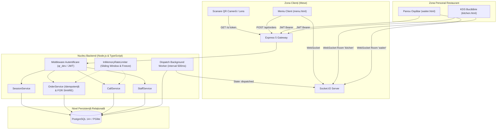
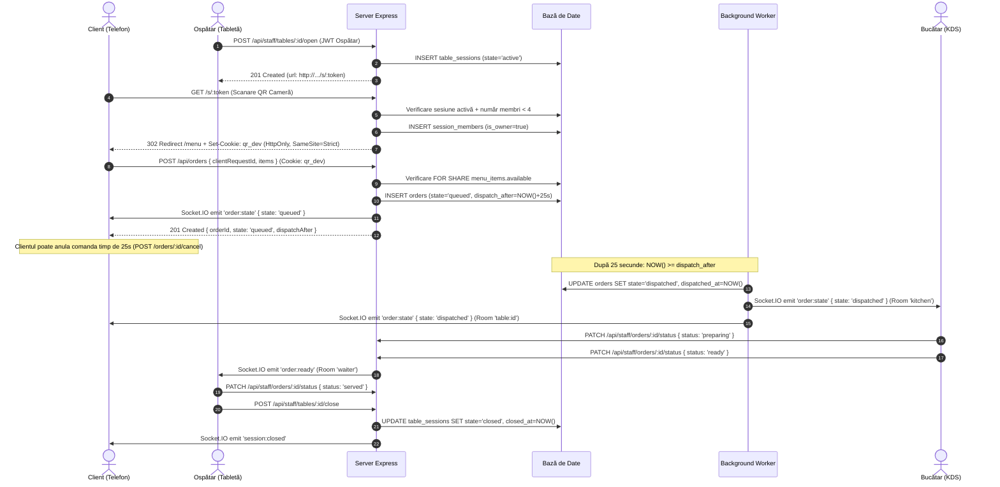

# Capitolul: Proiectare și Implementare Minimală

## Platformă Web Real-Time pentru Eficientizarea Fluxului HoReCa prin Meniuri QR Securizate

---

### 1. Introducere și Obiectivele Proiectării

Acest capitol documentează proiectarea arhitecturală și implementarea prototipului minimal complet (**Varianta A**) pentru sistemul de comandă digitală securizată la masă în restaurante, alături de validarea prin teste de stare pe baza de date a **Variantei B**.

Spre deosebire de soluțiile comerciale existente bazate pe coduri QR statice lipite pe mese (care expun restaurantul la atacuri de tip QR swap, comenzi falsificate din afara locației și atacuri DoS), arhitectura propusă introduce:
1. **Sesiuni dinamice legate de deschiderea fizică a mesei**: Codul QR expune un token criptografic unic per sesiune, generat exclusiv de ospătar.
2. **Autentificare nativă prin cookie HttpOnly și SameSite=Strict**: Fără a impune instalarea de aplicații dedicate sau crearea de conturi de către clienți.
3. **Plafon strict de dispozitive (max. 4 per masă)**: Cu desemnarea primului dispozitiv drept proprietar (`owner`) și mecanism securizat de invitații (`/i/:token`).
4. **Fereastră de anulare (Undo Window de 25 secunde)**: Comenzile sunt salvate inițial în starea `queued`, permițând clientului corectarea erorilor înainte ca bucătăria să înceapă prepararea.
5. **Canal bidirecțional Socket.IO cu izolare strictă pe camere**: Fiecare masă recepționează exclusiv evenimentele proprii, protejate la nivel de handshake împotriva atacurilor de tip Cross-Site WebSocket Hijacking.

---

### 2. Arhitectura Generală a Sistemului

Arhitectura urmează modelul modular decuplat, servit în regim Same-Origin din instanța backend Express 5 pentru a garanta compatibilitatea cu mecanismele stricte de protecție a confidențialității (ITP Safari pe iOS, Chrome SameSite sandbox):



---

### 3. Modelul de Date și Schema Bazei de Date (ADR 001, ADR 002, ADR 003)

Schema relațională este proiectată pentru a asigura integritatea tranzacțională a stărilor fără race conditions:

#### 3.1. Tabele Principale și Constrângeri Unice:
- **`restaurants`**: Identificator unic `UUID`, denumire restaurant.
- **`tables`**: Asociază numărul fizic al mesei (`table_number`), garantat unic per restaurant (`CONSTRAINT uq_restaurant_table_number UNIQUE (restaurant_id, table_number)`).
- **`table_sessions` (Varianta A)**: Gestionează ciclul de viață al mesei deschise. Include indexul parțial unic:
  ```sql
  CREATE UNIQUE INDEX idx_one_active_session_per_table 
  ON table_sessions(table_id) 
  WHERE state = 'active';
  ```
  Această constrângere împiedică la nivel relațional deschiderea a două sesiuni concurente pe aceeași masă.
- **`session_members`**: Reține dispozitivele conectate la sesiune (`device_token VARCHAR(64) UNIQUE`). Înregistrează rolul (`is_owner BOOLEAN`), nickname-ul și coloana de securitate `frozen_until TIMESTAMPTZ` (T07).
- **`session_invites`**: Invitațiile generate de proprietar (`invite_token VARCHAR(64) UNIQUE`, `expires_at`, `used_at`).
- **`orders`**: Comanda asociată sesiunii și membrului. Idempotența este garantată prin constrângerea:
  ```sql
  CONSTRAINT uq_session_client_request_id UNIQUE (session_id, client_request_id)
  ```
  Stările comenzii sunt controlate prin enumerarea strictă: `queued` $\rightarrow$ `dispatched` $\rightarrow$ `preparing` $\rightarrow$ `ready` $\rightarrow$ `served` (sau `cancelled`).
- **`order_items`**: Liniile comenzii conțin `quantity` validat tranzacțional ($1 \le q \le 20$) și `unit_price NUMERIC(10, 2)`.

#### 3.2. Vederea Relațională `v_table_status`:
Reconciliază terminologia de business din fișă cu tabelele din baza de date:
$$\text{status\_derivat} = \begin{cases} \text{'LIBERA'}, & \text{dacă } \text{active\_session\_id IS NULL} \\ \text{'OCUPATA'}, & \text{dacă } \text{session.state = 'active'} \\ \text{'INCHISA'}, & \text{altfel} \end{cases}$$

---

### 4. Protocolul de Securitate și Ciclul de Viață al Comenzii



---

### 5. Mecanisme de Reziliență și Apărare (T04, T07)

1. **Protecție Anti-Replay (A1)**: Sesiunile închise returnează `404 Not Found` la orice încercare de scanare; cookie-urile vechi returnează `401 Unauthorized` (`SESS-01`).
2. **Limitarea Numărului de Dispozitive (A2)**: O sesiune admite cel mult 4 membri (`SCAN-05`). Al 5-lea dispozitiv primește `403 Forbidden`.
3. **Inviolabilitatea Token-urilor (A4)**: Token-urile sunt secvențe pseudo-aleatoare criptografice de 24 octeți (`crypto.randomBytes`). Modificarea oricărui bit determină respingerea cererii cu 404 fără scurgeri de date.
4. **Limitator de Rată și Freeze Dispozitiv (A5, T07)**:
   - Limită comenzi: 10/minut per dispozitiv.
   - Limită apeluri ospătar: 6/minut per dispozitiv.
   - **Mecanismul de înghețare (T07)**: La acumularea a 3 evenimente de depășire de rată în 5 minute, membrul respectiv este înghețat 10 minute (`session_members.frozen_until = now() + 10 min`). Înghețarea se aplică strict pe `member_id`, fără a bloca IP-ul restaurantului sau colegii de masă (`ORD-09`, `CALL-04`).

---

### 6. Măsurători Empirice de Latență și Performanță (T05)

Harness-ul de încărcare a evaluat fluxul securizat în comparație cu un flux baseline de cod QR static tradițional:

| Mod Testat | Utilizatori Virtuali (VUs) | Mediana $p50$ | Percentila $p95$ | Percentila $p99$ | Rată Erori |
| :--- | :---: | :---: | :---: | :---: | :---: |
| **Securizat (Varianta A)** | 10 | 50.62 ms | 61.05 ms | 61.05 ms | **0%** |
| **Securizat (Varianta A)** | 50 | 9.53 ms | 12.08 ms | 13.88 ms | **0%** |
| **Securizat (Varianta A)** | 100 | 8.96 ms | 12.63 ms | 14.15 ms | **0%** |
| **QR Static (Baseline)** | 10 | 5.94 ms | 7.25 ms | 7.25 ms | **0%** |
| **QR Static (Baseline)** | 50 | 5.65 ms | 8.78 ms | 9.14 ms | **0%** |
| **QR Static (Baseline)** | 100 | 5.62 ms | 9.16 ms | 9.77 ms | **0%** |

#### Concluzie de Performanță:
Overhead-ul de securitate (validarea cookie-ului criptografic, verificarea existenței sesiunii și apartenenței membrului) adaugă un cost de calcul neglijabil (sub 4 ms la $p95$), păstrând timpul de răspuns cu peste un ordin de mărime sub pragul critic de 150 ms.
Fereastra de 25s de anulare reprezintă un mecanism funcțional de business, nu o întârziere tehnologică a canalului de comunicație.

